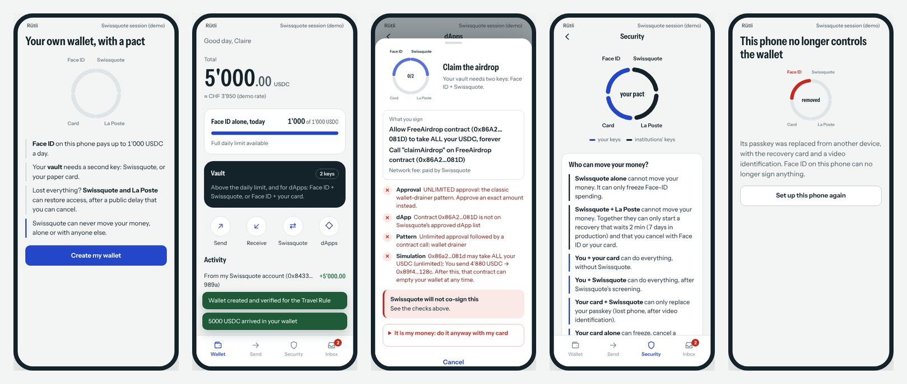
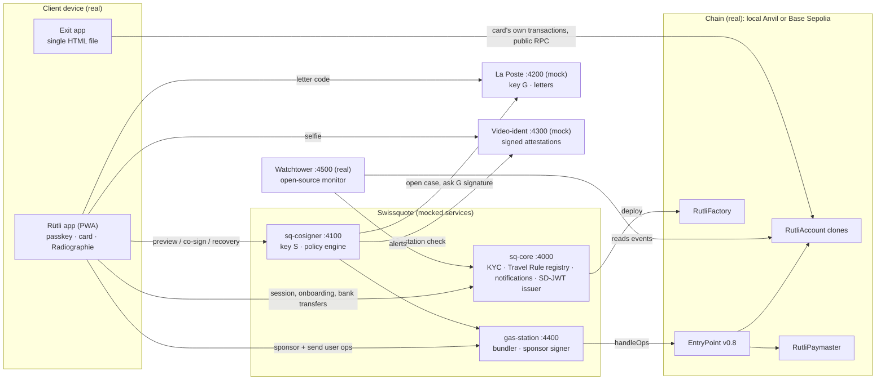

# Rütli — the self-custody wallet Swissquote could launch

**Swissquote Wallet Challenge, EPFL Hackathon, October 2026.**

Rütli is named after the 1291 pact between three Swiss parties: nobody can betray the others alone.
The wallet works the same way. Four keys held by four different parties are bound by rules written in a
smart contract. **Swissquote can never move the client's money, alone or together with its partner.**
The client never depends on Swissquote, not even on its survival.

| Key | Held by | Where it lives |
|---|---|---|
| **P** passkey | the client | the phone's secure chip (Face ID / Touch ID), P-256 WebAuthn |
| **C** recovery card | the client | paper: 12 words + QR, printed at home, never on a device |
| **S** co-signer | Swissquote | HSM in production, one derived key per client (here: a separate process) |
| **G** guardian | La Poste (independent partner) | its own HSM, one key per client (here: a separate process) |



## The pact, enforced on-chain

These are the rules of [`RutliAccount.sol`](contracts/src/RutliAccount.sol), function `canAuthorize`. They are tested
exhaustively for all 16 factor combinations in [`AuthorizationMatrix.t.sol`](contracts/test/AuthorizationMatrix.t.sol).

| Who signs | What they can do | Delay |
|---|---|---|
| Face ID alone (P) | spend up to a **daily allowance** (the "porte-monnaie", 1'000 USDC) | none |
| Face ID + Swissquote (P+S) | anything; Swissquote screens, simulates, and can hold first-time large transfers | none (24 h cool-off off-chain) |
| Face ID + card (P+C) | anything, **without Swissquote** | none |
| Card + Swissquote (C+S) | only replace the passkey (lost phone, after video identification) | none |
| Swissquote + La Poste (S+G) | only **start** a recovery of both client keys | 7 days, **cancellable by the client** (Face ID or card) |
| Card alone (C) | freeze, cancel, or **start an exit** that removes Swissquote | 30 days, cancellable by Face ID |
| Swissquote alone, La Poste alone | freeze Face-ID spending, nothing else | — |

The client always has a route that needs nothing from Swissquote. Swissquote never has a route that needs nothing from the client.

## What is real and what is mocked

| Component | Status | Notes |
|---|---|---|
| Smart contracts (account, factory, paymaster) | **Real** | Solidity 0.8.28, OpenZeppelin 5.6.1, ERC-4337 EntryPoint v0.8. 92 Foundry tests, including fuzzing and invariants |
| Passkeys | **Real** | Browser WebAuthn (Face ID / Touch ID / Windows Hello), verified on-chain with OpenZeppelin `WebAuthn` + P-256 (RIP-7212 / EIP-7951 precompile, Solidity fallback) |
| Recovery card | **Real** | BIP-39 words → secp256k1 key, generated in the browser |
| Transactions | **Real** | Every operation is a real ERC-4337 user operation through the real EntryPoint, on a local chain or Base Sepolia |
| Gasless | **Real** | On-chain verifying paymaster; the client's wallet holds 0 ETH |
| Exit app, watchtower | **Real** | They only read and write public chain data |
| Swissquote core banking | Mock | Clients, KYC, custodial balances, Travel Rule registry, notifications, SD-JWT credential issuer |
| Swissquote co-signer | Mock of an HSM-backed service | Separate process, its own storage and seed. Policy engine with sanctions screening, approved dApps, `eth_simulateV1` simulation, cool-off |
| La Poste guardian | Mock | Separate process, its own storage and seed. Mails a code to the postal address, signs only the exact recovery |
| Video identification | Mock | Separate process. Signs ES256 attestations that the co-signer verifies; demo personas stand in for the camera |
| Gas station | Mock infrastructure | Our own bundler and sponsor signer. Pimlico or Alchemy could replace it with no contract change |

Every mocked share holder runs as **its own process with its own data directory** (`services/data/<network>/<service>/`).
The client app never holds the co-signer's or the guardian's key.

## Architecture



## Quick start

Requirements: **Node.js ≥ 22.12** and **Foundry** (`curl -L https://foundry.paradigm.xyz | bash && foundryup`).
On Windows, use WSL2.

```bash
npm install          # also installs the Solidity dependencies (contracts/node_modules)
npm run build:contracts
npm run dev          # anvil + deployment + 6 services + app + exit app
```

Then open:

| URL | What |
|---|---|
| http://localhost:5173 | Claire's phone |
| http://localhost:5173/?device=new-phone | a second phone (its own passkey and storage) |
| http://localhost:5173/#/mailbox | Claire's physical mailbox (La Poste letters) |
| http://localhost:5173/#/ops | back-office: video-ident agent desk, co-signer decisions, La Poste, gas station, watchtower, chain clock |
| http://localhost:5174 | Exit app: the funds back with the card alone |

`npm run dev -- --fresh` restarts from a clean state. The demo delays are seconds (recovery 2 min, exit 3 min, cool-off
60 s) instead of days. The back-office can also move the local chain's clock forward.

No Face ID on the demo laptop? Choose "Use the demo authenticator": it produces the same WebAuthn signatures with a key
kept in the browser.

## Tests

```bash
npm run test:contracts   # 92 Foundry tests: unit, authorization matrix, fuzz, invariants, the story
npm run test:sdk         # TypeScript SDK (signature encoding, WebAuthn, card)
npm run e2e              # the whole story through the HTTP APIs, against the running stack
npm run test:ui          # the story in Chromium with a virtual WebAuthn authenticator + screenshots
npm run typecheck
```

`forge test --match-test test_TheWholeStory -vv` prints the story on-chain:
create → gasless payment → co-signed transfer → theft → freeze → new phone → Swissquote disappears → exit.

## Repository

```
contracts/          Foundry project
  src/RutliAccount.sol      the pact: ERC-4337 account, factors, allowance, recovery, exit, freeze, ERC-1271
  src/RutliFactory.sol      deterministic, non-upgradeable clones (CREATE2 salt commits to the keys)
  src/RutliPaymaster.sol    verifying paymaster (Swissquote sponsorship)
  src/demo/                 test USDC, an approved ERC-4626 vault, a wallet drainer
  test/                     unit, matrix, paymaster, factory, dApps, invariant, story
packages/sdk/       shared TypeScript: ABIs, user ops, factor signatures, WebAuthn, recovery card, decoding
services/src/       sq-core, sq-cosigner, poste-guardian, video-ident, gas-station, watchtower
app/                React app (Vite)
exit-app/           single-file exit app (vite-plugin-singlefile)
scripts/            setup (deploy), dev (launcher), e2e, ui-test, gen-abis
docs/               security model, legal analysis, business case, demo script, French guide, AI tools
```

## The challenge's six required topics

| Topic | Where |
|---|---|
| 1. Custody model and threat model | [docs/SECURITY.md](docs/SECURITY.md): decision, alternatives, threat model, invariants |
| 2. Architecture (real vs mocked) | this README; [docs/SECURITY.md](docs/SECURITY.md#key-custody) |
| 3. Wallet creation | `app/src/screens/Onboarding.tsx`, `services/src/sq-core` (`/wallet/prepare`, `/wallet/activate`) |
| 4. Authentication, small vs high value | daily allowance on-chain; co-signer policy, cool-off and step-up (`services/src/sq-cosigner`) |
| 5. Recovery (lost, stolen, destroyed; Swissquote gone; attacker refused) | `app/src/screens/Recover.tsx`, `exit-app/`, `scripts/e2e.ts` steps 8–14 |
| 6. Business case | [docs/BUSINESS.md](docs/BUSINESS.md) |

Legal feasibility (custody, Travel Rule, banking secrecy): [docs/LEGAL.md](docs/LEGAL.md).

## Bonus topics

**Gasless.** `RutliPaymaster` pays gas from Swissquote's deposit in the EntryPoint. The gas station signs a
sponsorship bound to one exact operation, valid 15 minutes. Abuse prevention:

- only Rütli wallets are sponsored;
- monthly quota per wallet;
- operations that would revert are simulated and refused;
- counterparties are screened;
- security operations (freeze, recovery, cancellations) are always free.

The client never holds ETH. If Swissquote is gone, the exit needs a few cents of ETH on the card's address, nothing else.

**Compliant dApp interaction.** The co-signer shows, before Face ID, a plain-language description of what will be
signed and the result of an `eth_simulateV1` simulation ("you send 200 USDC, you receive 200 hyUSDC"). It applies:

- an approved-dApp list;
- exact approvals only;
- detection of the drainer pattern (unlimited approval followed by a call);
- OFAC and SECO screening;
- Travel Rule classification of the counterparty;
- a cool-off for first-time large transfers.

A passkey alone can never approve or call a dApp: that is enforced on-chain.

## Deploy on Base Sepolia

```bash
cp .env.example .env    # DEPLOYER_PRIVATE_KEY funded with Base Sepolia ETH (faucet)
npm run setup:base-sepolia
npm run dev -- --network base-sepolia
```

The script reuses the canonical EntryPoint v0.8 (`0x4337084D9E255Ff0702461CF8895CE9E3b5Ff108`) if present, otherwise it
deploys one. It funds the paymaster deposit, the bundler and the bank's omnibus wallet.

## AI tools

See [docs/AI_TOOLS.md](docs/AI_TOOLS.md). Complete it with your own use before submitting.

## License

MIT. Hackathon prototype: not audited. Do not use with real funds.
